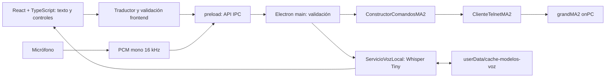

# ClauCode Lights

ClauCode Lights es una aplicación de escritorio para preparar y enviar órdenes de iluminación a **grandMA2 onPC** desde una interfaz en español. Reúne texto, dictado con Whisper local y controles de cabina para que los operadores del Club de Arte y Cultura puedan seleccionar grupos, ajustar niveles, aplicar presets y manejar escenas desde un mismo lugar.

El software construye comandos grandMA2 y los entrega por Telnet. Una entrega correcta confirma que el comando se escribió en el socket; **no confirma que una luminaria haya respondido**. Las pruebas con la consola, el showfile y las salidas físicas siguen el procedimiento de validación indicado al final.

## Funcionalidades implementadas

| Área | Función disponible |
| --- | --- |
| Órdenes en español | El traductor interpreta intensidades, colores del catálogo y acciones de escena. Muestra una vista previa y rechaza órdenes ambiguas, contradictorias o inválidas antes del envío. Admite órdenes compuestas para los casos previstos por el traductor. |
| Voz local | El botón **Hablar** captura audio, lo remuestrea a PCM mono de 16 kHz y solicita transcripción en español a Whisper Tiny dentro de Electron. Con la autoejecución desactivada, deja el texto en **Orden de Iluminación** para revisarlo y enviarlo con Enter o **Ejecutar**. |
| Grupos e intensidad | Clic selecciona un grupo; Ctrl+Clic permite varios; **Todos** selecciona el catálogo completo. Cada tarjeta muestra color, porcentaje y barra de nivel. Hay botones de **0%, 25%, 50%, 75% y 100%** y un slider que confirma el valor al soltarlo. |
| Color | Los botones redondos envían presets del Pool 4 configurados para la selección. **Rueda** ofrece una vista previa y busca el preset más cercano mediante distancia CIE76 (ΔE76); **Aplicar color** envía ese preset. El color en pantalla es una aproximación visual. |
| Escenas | La barra **Escenas** incluye **Anterior**, **Siguiente**, campo **Escena** con **Ir** y **Detener**. Usa el executor configurado en **Ajustes**. |
| Seguimiento | **Actividad** muestra comandos entregados y errores; la entrada nueva destaca brevemente. **Deshacer** intenta restaurar el estado anterior representable de los grupos afectados por un envío; no deshace cues ni garantiza restauración física. El campo de texto conserva un historial de órdenes enviadas. |
| Ajustes y estado | **Ajustes** edita conexión, executor, grupos, colores, tema y autoejecución de voz. Los cambios del catálogo se aplican en caliente; cambiar host, puerto o credenciales inicia la reconexión Telnet. La cabecera indica **Conectando...**, **Autenticando...**, **Conectado**, **Reconectando...** o **Sin conexión**. |
| Apariencia | **Modo Cabina (Oscuro)** y **Modo Día (Gris Suave)**. Un único aviso en cápsula inferior señala errores y eventos importantes; los envíos normales quedan en **Actividad**. |

Estas funciones se han inspeccionado en el código y tienen pruebas automáticas para partes concretas. La respuesta de grandMA2 onPC, la experiencia visual en Electron y la operación completa sin internet requieren las pruebas manuales descritas más abajo.

## Arquitectura técnica

La interfaz está hecha con React y TypeScript. `frontend/src/diccionario/TraductorLuces.ts` interpreta el texto; `frontend/src/seguridadComandos.ts` valida antes de despachar. `src/preload.ts` expone una API limitada mediante IPC (comunicación entre la ventana y el proceso principal de Electron). `src/main.ts` vuelve a validar el payload, `ConstructorComandosMA2` genera la sintaxis y `ClienteTelnetMA2` gestiona autenticación, envío y reconexión TCP/Telnet.



La rama de audio usa `ma2:transcribir-audio` para enviar las muestras al servicio local y `ma2:progreso-voz` para mostrar el avance durante **Transcribiendo...**. Whisper devuelve texto, que vuelve al traductor y a la validación de la interfaz. La configuración viaja por IPC al gestor de configuración; no se envía como comando de iluminación.

### Comandos grandMA2 generados

| Acción | Sintaxis que construye el backend |
| --- | --- |
| Intensidad | `Group 1 At 50` |
| Color por preset | `Group 1 At Preset 4.2` |
| Siguiente / anterior | `Go Executor 1` / `GoBack Executor 1` |
| Ir a una escena | `Goto Cue 3 Executor 1` |
| Detener secuencia | `Off Executor 1` |

Son **ejemplos de sintaxis**, no instrucciones para introducir directamente en el campo de texto. Los números dependen del grupo, preset, cue y executor configurados. El constructor añade el terminador de línea Telnet y valida rangos y formatos antes de escribir al socket.

## Requisitos previos

- Windows con Node.js y npm disponibles en la terminal. El proyecto no declara una versión mínima de Node.js; usa una instalación compatible con las dependencias de `package.json` y `frontend/package.json`.
- grandMA2 onPC accesible por TCP/Telnet, con Remote Command habilitado y una cuenta de prueba autorizada. El host, puerto, grupos, presets y executor deben corresponder al showfile utilizado.
- Conectividad local entre la laptop y onPC. Para descargar Whisper Tiny por primera vez, hace falta acceso a internet si el modelo aún no está en caché.
- Micrófono y permiso de acceso de Windows para usar **Hablar**. Texto y controles no requieren micrófono.

Para ensayos de iluminación, usa un **showfile de prueba con salidas físicas aisladas**. Nunca ejecutes **Blackout** sobre una función activa.

## Instalación, compilación y ejecución

Desde la raíz del repositorio:

```powershell
npm install
npm --prefix frontend install
```

Para compilar y ejecutar las pruebas disponibles:

```powershell
npm run build
npm --prefix frontend run build
npm test
```

Para iniciar la aplicación de escritorio:

```powershell
npm run start:all
```

`start:all` compila frontend y backend y abre Electron. La ventana carga `frontend/dist/index.html`; el proceso principal intenta conectarse al destino Telnet configurado. Si PowerShell bloquea el alias `npm.ps1`, usa el ejecutable `.cmd` con los mismos argumentos, por ejemplo `npm.cmd run start:all` o `npm.cmd --prefix frontend run build`. El script `npm run start` solo recompila el backend y abre Electron: requiere que el frontend ya esté compilado.

## Configuración

El archivo `config.json` de la raíz es la **plantilla inicial**. Al arrancar, `GestorConfiguracion` lee o crea la copia activa en `app.getPath('userData')/config.json`; los cambios hechos en **Ajustes** se guardan allí. Si la copia está ausente o es inválida, el gestor usa la plantilla válida o los valores por defecto. Haz una copia antes de editarla manualmente: un archivo corrupto puede ser reemplazado durante esa recuperación.

| Campo | Uso |
| --- | --- |
| `conexion.host`, `conexion.puerto` | Dirección y puerto Telnet de grandMA2 onPC. Puerto entero entre 1 y 65535. |
| `conexion.usuario`, `conexion.contrasena` | Credenciales de la cuenta Telnet autorizada; cadenas no vacías. No las compartas en capturas ni en incidencias. |
| `executorPorDefecto` | Executor para acciones de escena; entero entre 1 y 999. |
| `grupos[]` | Cada elemento tiene `id`, `nombre`, `descripcion` y `sinonimos[]` para interpretar nombres en español. |
| `colores[]` | Cada elemento tiene `id`, `nombre`, `preset` del Pool 4, `hex` visual y `sinonimos[]`. El HEX no es el dato que se envía a grandMA2. |
| `interfaz.tema` | `cabina` o `dia`. |
| `interfaz.autoEjecutarVoz` | `false` para revisar el texto antes de enviarlo; `true` para despachar automáticamente una orden reconocida y válida. |

Ejemplo **parcial** de conexión de ensayo, con valores de reemplazo que no son credenciales reales:

```json
{
  "conexion": {
    "host": "127.0.0.1",
    "puerto": 30000,
    "usuario": "USUARIO_DE_ENSAYO",
    "contrasena": "REEMPLAZAR_EN_AJUSTES"
  }
}
```

El archivo real también necesita `executorPorDefecto`, `grupos`, `colores` e `interfaz`. Es preferible editar esos campos desde **Ajustes → Conexión & Cabina**, **Grupos (G1–G6)** y **Colores (4.1–4.9)**. Guardar actualiza el diccionario y la vista sin reiniciar; un cambio de conexión provoca reconexión automática.

## Whisper y funcionamiento sin internet

`src/main.ts` crea `ServicioVozLocal` con la caché **`app.getPath('userData')/cache-modelos-voz`**. El modelo utilizado es `Xenova/whisper-tiny`. La primera transcripción descarga los recursos faltantes si hay internet; después pueden cargarse desde el almacenamiento local. El servicio distingue la carga local con «Cargando modelo local desde caché (Whisper Tiny español)...» del progreso de descarga remota. Si detecta JSON u ONNX dañados, aparta únicamente los archivos afectados y realiza un reintento de descarga. Esta recuperación requiere internet cuando hace falta descargar de nuevo los recursos.

Las pruebas automáticas usan archivos temporales y transcriptores simulados para verificar caché, recuperación y funcionamiento offline sin descargar modelos. Un diagnóstico histórico del 20-11-2026 ejecutó el modelo real desde una caché local existente sin acceso remoto, pero usó un tono sintético. El registro de Hito 4 conserva los fallos observados en la primera descarga H4-03/H4-03b y la prueba manual de voz offline H4-06. La descarga limpia con la nueva recuperación y la operación integral con grandMA2 siguen pendientes de validación manual.

## Manual rápido de operador de cabina

1. **Abrir:** en la raíz del proyecto, ejecuta `npm run start:all` y espera la ventana de Electron. Abre antes un showfile de ensayo en grandMA2 onPC y comprueba que la conexión Telnet de prueba esté habilitada.
2. **Comprobar conexión:** mira la cabecera. **Conectado** significa que grandMA2 confirmó el login; **Autenticando...** indica que el socket abrió pero aún no confirmó sesión; **Sin conexión** indica error o desconexión. **Conectando...** y **Reconectando...** señalan intentos en curso. El icono **Reconectar consola** actualiza la lectura de estado y configuración; el cliente Telnet hace los reintentos de red.
3. **Elegir grupos:** clic en una tarjeta; Ctrl+Clic para varios; **Todos** para el catálogo completo. Doble clic en una tarjeta, o clic en su porcentaje, alterna 0%/100% para ese grupo.
4. **Cambiar intensidad:** usa los botones **0%**, **25%**, **50%**, **75%** y **100%** o mueve el slider. El slider envía el valor final al soltar el puntero; con teclado, al soltar la tecla de ajuste. Comprueba la selección antes de enviar.
5. **Aplicar color:** pulsa un botón redondo; su nombre y preset aparecen al pasar el puntero. Se envía ese preset a los grupos seleccionados.
6. **Usar Rueda:** pulsa **Rueda**, elige un color y revisa el preset aproximado y ΔE76. **Cancelar** no envía; **Aplicar color** envía el preset indicado, no el HEX de la vista previa.
7. **Dictar o escribir:** escribe en **Orden de Iluminación** y revisa la vista previa antes de pulsar **Ejecutar** o Enter. Para voz, pulsa **Hablar** para iniciar y de nuevo para detener, o mantén presionado y suelta. Con la autoejecución desactivada en **Ajustes**, revisa la transcripción antes de enviarla.
8. **Controlar escenas:** en **Escenas**, usa **Anterior**, **Siguiente**, el campo **Escena** con **Ir** o **Detener**. Comprueba en **Ajustes** el **Executor por defecto (Cues)** antes de operar.
9. **Consultar atajos:** pulsa **?** junto a **Orden de Iluminación**. El código admite **Alt + 1…6** para seleccionar un ID de grupo, **Alt + 0** para todos, **Ctrl + K** o **/** para enfocar la orden, **Alt + Espacio** para mantener y hablar, y **↑ / ↓** para recorrer el historial cuando el campo de texto tiene el foco.
10. **Revisar o deshacer:** **Actividad** muestra la entrega de cada orden; **Deshacer** aparece cuando existe un estado de grupo restaurable. Confirma el efecto en onPC: la app no lee de vuelta el estado físico de las luminarias.
11. **Abrir Ajustes:** pulsa **Ajustes** para cambiar conexión, executor, nombres y sinónimos de grupos, presets, tema o autoejecución de voz. Guarda y revisa el resultado antes de continuar.
12. **Si se pierde conexión:** detén los envíos, consulta **Actividad** y el aviso inferior, verifica host, puerto y cuenta con el operador y espera el reintento automático. El icono **Reconectar consola** refresca la lectura, pero no fuerza una conexión nueva inmediata. No repitas órdenes cuyo resultado físico sea incierto.
13. **Blackout:** el primer clic arma **¿Confirmar Blackout?** durante unos 3,5 segundos; una segunda pulsación dentro de ese plazo envía el apagón general a los grupos configurados. Úsalo únicamente en un showfile de ensayo con salidas aisladas y **nunca durante una función activa**.

## Pruebas, límites y empaquetado

[VALIDACION_HITOS_2_Y_3.md](VALIDACION_HITOS_2_Y_3.md) registra fechas, resultados y alcance de las pruebas. [GUIA_PRUEBAS_MANUALES_HITOS_2_Y_3.md](GUIA_PRUEBAS_MANUALES_HITOS_2_Y_3.md) indica cómo verificar Electron, voz española, red desconectada y grandMA2 onPC. Las suites unitarias y el servidor Telnet simulado **no sustituyen las pruebas físicas ni la aceptación del Club de Arte y Cultura**.

### Empaquetado Windows RNF-08

Para compilar el instalador de escritorio para Windows x64:

```powershell
npm.cmd run dist:win
```

El script compila primero el backend y el frontend, y después genera un instalador NSIS con electron-builder. El nombre visible es **ClauCode Lights** y la versión proviene de `package.json`. El instalador se escribe en `release/` y la configuración persistente se crea dentro de `app.getPath('userData')`, sin escribir dentro del paquete.

La plantilla `config.json`, `dist/`, `frontend/dist/` y las dependencias de producción necesarias quedan dentro del paquete. Los binarios nativos de `onnxruntime-node` están configurados con `asarUnpack` para que puedan cargarse desde el sistema de archivos.

La validación técnica real del resultado se registra en [VALIDACION_EMPAQUETADO_RNF08.md](VALIDACION_EMPAQUETADO_RNF08.md).
